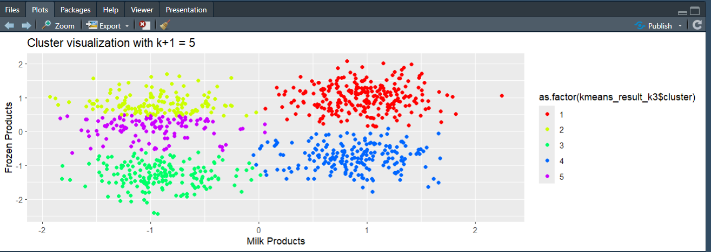
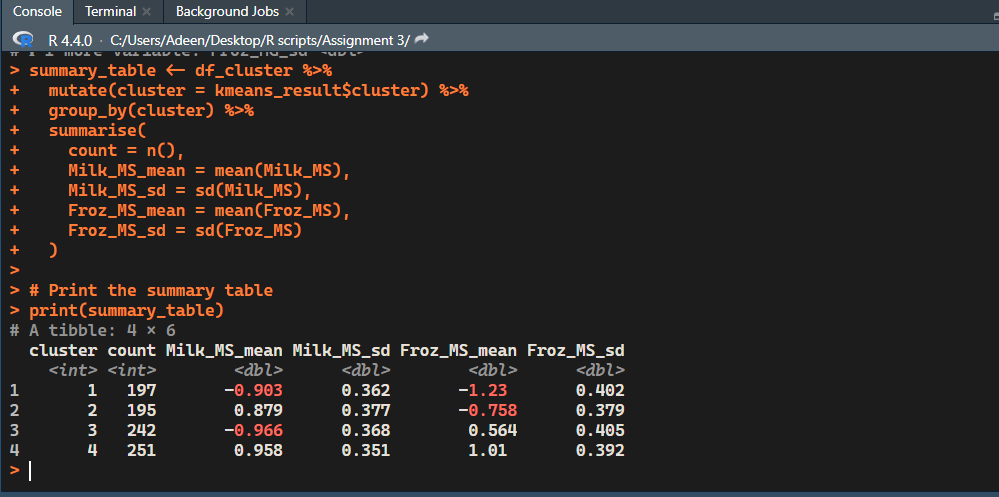
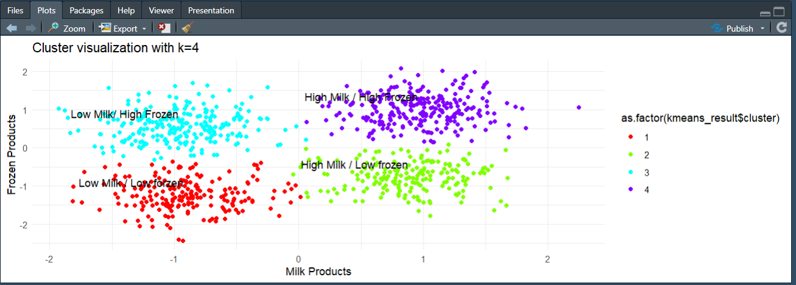

# Milk and Frozen Spending Clusters

**Author:** Mohammed Adeen Shaik  
**Review date:** 11 October 2026

## Research question

Can standardized milk and frozen spending reveal interpretable descriptive customer groups?

## Data and provenance

Coursework R script and original Clustering Documentation.docx; Dataset.txt is absent.

Source materials are linked from the repository README. Input fingerprints are recorded in [the evidence manifest](evidence.json) so a reader can identify the exact committed artifacts used in this review.

## Method and analytical rationale

The script standardizes numeric fields, inspects within-cluster sum of squares for k=2 through 7 and compares k=3, 4 and 5. The coursework selected four clusters for interpretability.

## Findings and interpretation

The original report selected **four milk/frozen spending clusters** after inspecting k=3, 4 and 5. This is a documented interpretability choice. The source Dataset.txt is missing, so no refreshed inertia, silhouette score or customer counts are claimed.

## Limitations

Four clusters are a coursework choice, not proof of an optimal population segmentation. Cluster numbering is arbitrary; names must be derived from fitted centers. No new metrics can be reproduced without the original data.

## Reproduction

Use the setup commands and input contract in the [repository README](https://github.com/Adeen1607/Clustering-With-R#readme). Open the [notebook catalogue](notebooks.html) for annotated code and saved outputs. Keep raw records and model binaries local; public reports contain aggregate results or source-embedded figures.

## Final visual results

*Historical figure image17.png from Clustering Documentation.docx; not a refreshed experiment.*

*Historical figure image18.png from Clustering Documentation.docx; not a refreshed experiment.*

*Historical figure image19.png from Clustering Documentation.docx; not a refreshed experiment.*

